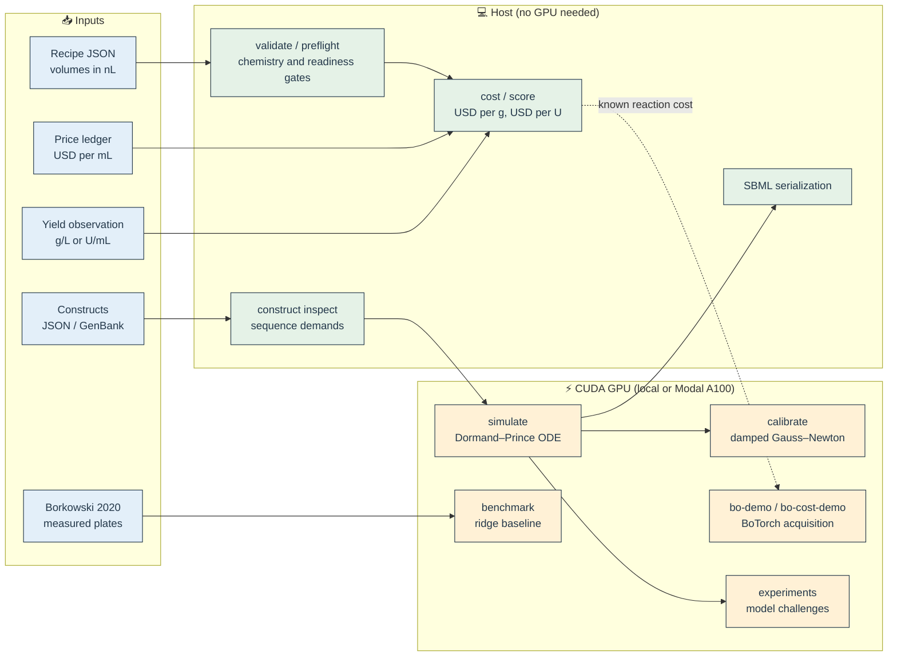
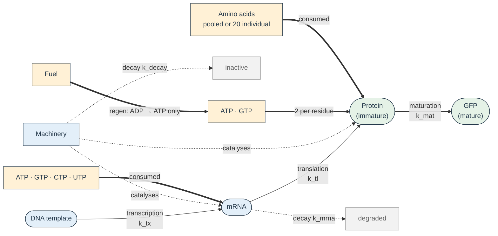

<div align="center">

# 🧬 cfps-sim

**Recipe accounting, a reduced GPU kinetic model, and Bayesian experiment design<br>for lysate-based cell-free protein synthesis (CFPS).**

[](https://github.com/m9h/cfps-sim/actions/workflows/checks.yml)


[](LICENSE)

[Quick start](#-quick-start) ·
[Commands](#-command-reference) ·
[Economics](#-production-economics) ·
[Model](#-model-boundaries) ·
[GPU](#-gpu-computation-and-numerical-accuracy) ·
[CI](#-continuous-integration) ·
[Article (PDF)](docs/article.pdf) ·
[Papers](#-papers)

</div>

A first computational stack for lysate-based CFPS: recipe accounting, a reduced
CUDA PyTorch model with SBML export, and a BoTorch experiment-selection
demonstration. Numerical execution requires a CUDA GPU; Modal provides a remote
GPU runner.

> [!WARNING]
> **Status: runnable research scaffold.** The kinetic constants are illustrative,
> the model is uncalibrated, and the BoTorch example uses synthetic observations.
> It does not predict competition winners. Recipe validation and simulation are
> separate workflows. Initial-pool mapping now requires explicit base chemistry and
> lysate backgrounds; a calibrated recipe-response model remains future work.

## 🗺️ What is in the box



| Area | What it does today | What it does **not** do |
| --- | --- | --- |
| 🧪 **Recipe accounting** | Checks volumes, increments, fixed inputs; reports known final mM | Infer endogenous lysate pools, free ions, pH or activity |
| 💵 **Economics** | Dispensed-reagent ledger, `USD/g` and `USD/U` from declared observations | Labor, assays, purification, plates, compute; official scoring |
| 🧬 **Constructs** | Versioned sfGFP / TfCut2 (PETase) / reteplase plasmids with checksums, GenBank exchange | DNA optimization or sequence-score-to-rate calibration |
| ⚙️ **Kinetic model** | Reduced resource ODE on CUDA `float64`, SBML export | Calibrated predictions; enzyme folding and activity models |
| 🎯 **Experiment design** | BoTorch acquisition on synthetic data, cost-aware objective | Dispensing-feasible competition candidate sets |
| 📊 **Benchmark** | Leakage-controlled ridge baseline on 1,017 measured formulation means | Reproduce the authors' policy or validate recipe ranking |

## 🚀 Quick start

On macOS, install uv with Homebrew if needed:

```sh
brew install uv
git clone https://github.com/m9h/cfps-sim.git
cd cfps-sim
uv sync --frozen --extra bo --extra cloud
```

```sh
uv run cfps-sim validate examples/recipe.json     # 💻 host
uv run cfps-sim simulate --output results/demo    # ⚡ CUDA
uv run --extra bo cfps-sim bo-cost-demo           # ⚡ CUDA
uv run pytest                                     # 💻 host subset; GPU tests skip without CUDA
```

uv uses the Python 3.11 version specified in `.python-version`; it can download
that interpreter if necessary. `uv.lock` pins dependencies. Native wheels are
used where available; no global Python packages are needed. COPASI is an optional
GUI for inspecting the exported SBML, not a runtime requirement.

> [!IMPORTANT]
> Simulation, calibration, and BoTorch acquisition require CUDA-enabled PyTorch
> and a visible NVIDIA GPU. Recipe accounting, sequence inspection, and SBML
> serialization can run on the development host. The numerical backend raises
> an error when CUDA is unavailable; it does not silently change execution devices.

## 🧰 Command reference

| Command | Runs on | Purpose |
| --- | :---: | --- |
| `cfps-sim validate RECIPE` | 💻 | Volume, increment and fixed-input checks; known final mM |
| `cfps-sim preflight RECIPE [--prices P] [--registry R] [--base B]` | 💻 | Audit chemistry and unresolved execution gates; **exits 2 while blocked** |
| `cfps-sim cost RECIPE PRICES` | 💻 | Dispensed-reagent ledger; missing prices stay missing |
| `cfps-sim score RECIPE PRICES OBSERVATION` | 💻 | `USD/g` or `USD/U` from a declared yield observation |
| `cfps-sim construct inspect CONSTRUCT [--aa-pools POOLS]` | 💻 | Sequence demands and a static amino-acid ceiling |
| `cfps-sim construct export-genbank` / `import-genbank` | 💻 | Exchange versioned constructs as GenBank |
| `cfps-sim simulate [--construct C] [--minutes N] [--output DIR]` | ⚡ | Integrate the model; write `trajectory.csv`, `model.xml`, `metadata.json` |
| `cfps-sim experiments [--construct C] [--seed N]` | ⚡ | Knockouts, conservation, sensitivity, grids, synthetic calibration study |
| `cfps-sim calibrate STUDY OBSERVATIONS` | ⚡ | Fit supported concentration observations with declared provenance |
| `cfps-sim benchmark` | ⚡ | Retrospective baseline on pinned measured CFPS data |
| `cfps-sim bo-demo` / `bo-cost-demo` | ⚡ | Yield-surface smoke test / cost-aware acquisition on synthetic data |

💻 = development host · ⚡ = requires CUDA (local GPU or `modal run modal_app.py`)

<details>
<summary><b>📁 Repository layout</b></summary>

```text
src/cfps_sim/        package: recipe, economics, preflight, construct, model, fitting, bo, benchmark, experiments, cli
tests/               pytest suite (GPU tests carry the `gpu` marker)
scripts/             docs build, benchmark fetch, registry/construct import, review prep, CI smoke test
examples/            example recipe, price ledgers (draft and illustrative), synthetic yield
constructs/          versioned competition plasmids (JSON + GenBank) and schema notes
data/registry/       reconciled stock registry and supplied competition draft
experiments/         local calibration proposal and data schema
benchmarks/          pinned source manifest for the Borkowski 2020 tables
reports/             recorded GPU benchmark result and pre-experiment review
docs/                executable article (Pweave source and built PDF)
modal_app.py         Modal A100 runner
```

</details>

## 🚦 Pre-experiment evidence and readiness

The registry reconciles 66 cached stock entries with the full draft supplied on
October 5, 2026. `data/registry/competition.supplied-draft.json` records the
source facts, target-specific lysates, incubation schedules, assays, geometry,
and unresolved rules. Draft prices are selected for provisional accounting;
54 differences from the older UI cache remain visible as historical conflicts.
Live availability and operative scoring approval are separate from that choice.

The fixed base contributes 30 mM HEPES, 200 mM potassium glutamate, 2.6 mM
magnesium glutamate, and 1 mM cysteine. Known analytical glutamate from those
salts is 205.2 mM. The reported 1 mM 18-AA base mixture remains unresolved at
the constituent level; mapping refuses to silently omit it. Potassium from
KOH titration and endogenous lysate pools are also not inferred. Salt accounting
reports analytical totals, not free ions, pH or validated activity.

```sh
uv run cfps-sim preflight examples/recipe.json --prices examples/prices.draft.json
uv run python scripts/prepare_review.py
uv run python scripts/fetch_benchmark.py
uv run cfps-sim benchmark                         # requires CUDA
uv run --extra cloud modal run modal_app.py --benchmark
```

`preflight` intentionally exits 2 while readiness gates are blocked.
`model_initial_conditions` requires explicit backgrounds for all supported NTP
and amino-acid pools, explicit other initial states, and resolved dispensed
chemical stocks and base amino-acid constituents. It returns missing-mechanism warnings with the mapping; this
is not a calibrated recipe response. `reports/pre_experiment_review.json`
contains prioritized diagnostic hypotheses and shortlist acceptance criteria,
with candidate rankings withheld pending in-domain evidence and reconciled costs.

The measured-data benchmark downloads ten pinned Borkowski author tables
(1,017 formulation means) into ignored `data/raw/borkowski2020`, verifies each
Git blob hash, and records SHA-256 provenance. Raw tables are not redistributed.
The benchmark uses source feature scales and relative yield, without an assumed
conversion to mass or competition reagents. The same group also built cell-free
analog adders and four-input perceptrons, and four authors are shared with the
formulation-optimization paper behind these tables
([DOI](https://doi.org/10.1038/s41467-019-11889-0)); formulation predictability is
the prerequisite both lines of work depend on. Plates 1–7 train the model; plate 8
selects linear/quadratic ridge and regularization; plate 9 calibrates intervals;
plate 10 tests predictions. Shared recipes are purged from earlier splits, and
all preprocessing is fitted on training data. Final fitting uses training and
validation plates only.

| Plates | Role |
| --- | --- |
| 1–7 | Train the model |
| 8 | Select linear/quadratic ridge and regularization |
| 9 | Calibrate intervals |
| 10 | Test predictions |


| Held-out plate 10 (A100, `reports/borkowski2020.gpu.json`) | Value | Reading |
| --- | ---: | --- |
| MAE, selected quadratic ridge (α = 10) | 0.581 | 🟢 better than the baseline |
| MAE, training-mean baseline | 1.011 | reference |
| Spearman rank correlation | −0.315 | 🔴 ranks recipes the wrong way round |
| Coverage of nominal 90% intervals | 61.8% | 🔴 under-covers |

The A100 result in `reports/borkowski2020.gpu.json` has MAE 0.581 versus 1.011
for a training-mean baseline, but Spearman correlation −0.315 and only 61.8%
coverage for nominal 90% intervals. This warns against using this baseline for
recipe ranking. Later active-learning plates are distribution-shifted; interval
coverage is an empirical check, not a guarantee. The benchmark neither reproduces
the authors' original policy nor validates Ginkgo predictions or cost savings.
Fetch the data before a remote benchmark or executable article build.

## 💵 Production economics

> [!NOTE]
> The project assumes **minimize specific production cost**; the draft repeatedly
> says "maximize" \$/g and requires clarification.

Under our economic interpretation:

$$\text{USD/g} = \frac{\text{reaction cost}}{\text{titer (g/L)} \times \text{reaction volume (L)}}$$

The ledger charges all dispensed stocks, including fixed lysate, base buffer,
DNA, and explicit water. Missing prices are reported and block a complete score.
It currently covers dispensed reagent costs, not labor, assays, purification,
plates, or compute. Confirm the official scoring scope and full price ledger.

```sh
uv run cfps-sim cost examples/recipe.json examples/prices.draft.json
uv run cfps-sim score examples/recipe.json examples/prices.illustrative.json \
  examples/yield.synthetic.json
uv run --extra bo cfps-sim bo-cost-demo
```

The first command now succeeds: the supplied draft lists the base buffer at
\$0.220/mL, giving \$0.02492395 for this illustrative reaction. Complete draft
arithmetic does not establish official scoring approval. The separate illustrative
ledger and yield file remain synthetic demonstrations; neither is an official
score or a demonstrated productive recipe. `score` accepts explicit, source-matched
`g/L` or `U/mL` observations and keeps `USD/g` separate from `USD/U`. Apparent
enzyme g/L requires an audited assay conversion; raw fluorescence or activity
must not be silently treated as mass. Zero product is unscorable.

`bo-cost-demo` models synthetic log titer and applies known toy reaction costs
to both observed and candidate posterior samples. It selects expected improvement
in `log(g/USD)` using noisy Monte Carlo acquisition. This accounts for production
cost within the objective; the original `bo-demo` remains a yield-surface smoke
test. Neither BO example uses experimental competition observations or an
implemented recipe-to-model mapping. Highest yield and lowest USD/g can select
different points. Report both raw yield and cost, retain the cost/yield Pareto
front, and rank competition candidates by their target-specific economic score.

## 🔬 Local calibration and competition execution

`experiments/local-calibration.json` proposes local experiments using matching
Ginkgo CFPS or bulk standard lysate for sfGFP/TfCut2 and CFPS Disulfide/DSB lysate
for reteplase. Purchased lots may differ from competition lots. Sepia extract
and b.next PURE systems provide comparison and mechanism-isolation tracks with
separate effective parameters. No purchase, contact or experiment submission
has been made.

| Target | Lysate | Incubation | Assay |
| --- | --- | --- | --- |
| 🟢 **sfGFP** | Ginkgo CFPS or bulk standard | 20 h at 30 C | Fluorescence (simulation supported) |
| 🧴 **TfCut2** (PETase) | Ginkgo CFPS or bulk standard | 20 h at 30 C | p-nitrophenol hexanoate esterase activity, nominal 600-fold dilution, 60 C/10 min pre-assay treatment |
| 🩸 **Reteplase** | CFPS Disulfide/DSB | 10 h at 30 C, 2 h at 4 C, 8 h ambient | IPR-AMC cleavage |

All three use the existing versioned circular plasmids at 5 nM and 25% lysate.
The paragraphs below carry the caveats that the table cannot.

Match the existing versioned circular plasmids at 5 nM, 25% lysate and the
source assay definitions. sfGFP and TfCut2 incubate 20 h at 30 C. Reteplase uses
DSB lysate and 10 h at 30 C, 2 h at 4 C and 8 h ambient before its assay.
TfCut2 uses p-nitrophenol hexanoate esterase activity, a nominal 600-fold reaction
dilution and a 60 C/10 min pre-assay treatment; it is not a direct PET degradation
measurement. Reteplase uses IPR-AMC cleavage. Both use reverse product/substrate
standards and kinetic readouts. Raw OD405/h or RFU/h must not be silently relabeled
U/mL or protein mass; official activity-unit conversion remains unspecified.

All three competition stages retain **20 uL reactions**, including the final
2-mL tube vessels. Match geometry, seals, incubation and lot metadata when
assessing transfer. The participant submission section specifies 80 designs
with four identical replicates each, 320 wells in columns 5–24, and reserved
columns 1–4. Later extra-control wording conflicts with that allocation.
The reagent allowance is bracketed as [20] or [10 or 20]. These unresolved rules,
the 18-AA base mixture, and a standard-dilution labeling inconsistency are
preserved in the contract. The linked `autonomous-cfps` repository returned 404
from public access; our preflight is not its authoritative plate validator.

## 📄 Executable article

`docs/article.Pnw` documents the model, assumptions, recipe constraints,
optimization, and GPU workflow. Its figure and numerical recipe summary are
generated from the package with Pweave; Tectonic builds the PDF.
The introduction also covers CFPS history, a curated modern reading guide,
and Joongoo Lee's POSTECH i-POPFLEX work presented in the Build-a-Cell series.
The concise abstract summarizes the implemented scope and remaining validation gaps.
The article also distinguishes measured CFPS formulation improvements from
Illinois iBioFAB's enzyme-activity and metabolic-production results, and proposes
assay calibration, module-swap experiments, and prospective comparisons of search
policies under equal experimental budgets. These experimental steps remain planned.

```sh
brew install tectonic
uv sync --frozen --extra bo --extra cloud --extra docs
uv run --extra docs python scripts/build_docs.py
```

The output is `docs/article.pdf`. The initial build may download TeX support
files. Generated TeX and figures are ignored; the article source and PDF are tracked.
`AGENTS.md` requires updating the article and rebuilding its PDF when scientific
behavior, assumptions, workflows, or validation change.

The simulator writes `trajectory.csv` and `model.xml`. Time is in minutes and
concentrations in mM. `Protein` is immature protein and `GFP` is mature protein;
neither is calibrated fluorescence. Without `--construct`, sequence counts remain
illustrative placeholders. With a supplied sfGFP construct, the model uses its
CDS-derived amino-acid counts and assumed-transcript NTP counts.

## 🧬 DNA constructs and Popcorn exchange

The three competition plasmids are saved as versioned JSON and GenBank artifacts
in `constructs/competition/`, with source provenance and sequence checksums. Their
CDS translations match the proteins in the draft rules, including tags.
[Construct documentation](constructs/README.md) specifies the schema and the
assumed transcript boundaries. These are supplied templates; custom DNA is not
an established competition submission variable.

```sh
uv run cfps-sim construct inspect constructs/competition/sfgfp.json
uv run cfps-sim simulate --construct constructs/competition/sfgfp.json --output results/sfgfp
uv run cfps-sim construct export-genbank constructs/competition/sfgfp.json --output results/sfgfp.gb
uv run cfps-sim construct import-genbank results/sfgfp.gb --output results/sfgfp.json
```

Keep `m9h/popcorn` in its own environment and exchange GenBank artifacts. Import
requires a complete expression construct with one CDS and an mRNA annotation,
or explicit zero-based `--transcript-start` and `--transcript-end` coordinates.
The existing Popcorn example's CDS-only output and random-sequence fallback
are not verified competition constructs. No sequence-score-to-rate calibration
or DNA optimization is implemented here.

`construct inspect --aa-pools pools.json` accepts a map of canonical one-letter
amino-acid codes to available mM and calculates a static stoichiometric ceiling.
It excludes synthesis, recycling, and unknown lysate pools. Inspection works for
all three targets; simulation currently accepts sfGFP only because enzyme folding
and activity observation models are still required. Simulation also writes
`metadata.json` with sequence demands and explicit model assumptions.

## ⚡ GPU computation and numerical accuracy

The implemented backend uses PyTorch CUDA for the ODE solver, parameter fitting,
Gaussian processes, and acquisition evaluation. State tensors and GP calculations
use `float64`; `torch.compile` fuses per-step flux calculations on the GPU.
Adaptive Dormand–Prince integration uses `rtol=1e-10` and
`atol=1e-14`; the challenge suite repeats the endpoint calculation at
`rtol=1e-12`, `atol=1e-16`. These are numerical error controls, not guarantees
of predictive accuracy. Conservation, nonnegativity, missing-resource controls,
and tolerance refinement must pass on the target GPU.

| Numerical control | Setting |
| --- | --- |
| Precision | `float64` state tensors and GP calculations |
| Integrator | Adaptive Dormand–Prince (torchdiffeq), `torch.compile`-fused fluxes |
| Production tolerances | `rtol=1e-10`, `atol=1e-14` |
| Refinement check | `rtol=1e-12`, `atol=1e-16` |
| Calibration | Bounded damped Gauss–Newton in log-parameter space, two starts |
| Fit rejection | Jacobian disagreement above 0.1% between two perturbation sizes |

Calibration uses bounded damped Gauss–Newton in log-parameter space. Residuals,
finite-difference Jacobians, and linear solves stay on CUDA. Two starts check
local sensitivity; Jacobians are compared at two perturbation sizes, and
conditional covariance uses an SVD. Convergence uses scaled gradient, objective,
or step criteria; Jacobian disagreement above 0.1% rejects fit success. Artifacts record GPU identity, PyTorch/CUDA
versions, solver tolerances, and fit diagnostics. Host code handles inputs,
reporting, and serialization.

The BO demo fits twelve synthetic observations and selects from a normalized
grid. This demonstrates acquisition only; it is not a dispensing-feasible
competition candidate set. Better biological accuracy requires measured time
courses, an audited assay mapping, identifiable parameters, and validation on
whole held-out recipes and lysate batches. GPU execution alone does not supply
that evidence.

[PyTorch numerical accuracy](https://docs.pytorch.org/docs/stable/notes/numerical_accuracy.html)
and [torchdiffeq](https://github.com/rtqichen/torchdiffeq) describe the numerical
backend. A JAX GPU/TPU implementation would be a separate future backend; none
is implemented or validated here.

## ☁️ Run on Modal GPU

```sh
uv run --extra cloud modal setup
uv run --extra cloud modal run modal_app.py
uv run --extra cloud modal run modal_app.py --construct constructs/competition/sfgfp.json
# Run GPU tests, challenge/calibration checks, and rebuild the executable article:
uv run --extra cloud modal run --detach modal_app.py --verify --build-docs --background
# Retrieve the printed function-call ID once complete:
uv run --extra cloud modal run modal_app.py --retrieve fc-...
```

The runner requests an A100 GPU and builds the locked Linux environment.
Results go to `results/modal/`; `--build-docs` also replaces `docs/article.pdf`
with the GPU-generated article. The on-demand function has a one-hour timeout.

> [!CAUTION]
> [Modal GPU compute](https://modal.com/docs/guide/gpu) is billed to the authenticated
> account.

A CUDA-enabled RunPod host can run the same locked package and commands;
no provider-specific RunPod integration is included.

All 18 tests passed on a Modal A100 GPU on September 30, 2026, including
conservation, solver refinement, parameter recovery, holdout isolation, and
acquisition checks. These validate software behavior; measured biological
accuracy remains unestablished. The suite has since grown to 23 tests
(16 host, 7 GPU); rerun the GPU verification command above for the complete suite.
Hosted GitHub CI covers the host subset only; a manually started workflow runs the
complete suite on Modal, as described below.

## ✅ Continuous integration

Hosted GitHub runners have no CUDA GPU, so [CI](.github/workflows/checks.yml)
verifies everything that is meant to work on a development host and confirms
that numerical commands refuse to run rather than fall back to CPU.

| Job | Runs | Catches |
| --- | --- | --- |
| 🧹 **Lint and lockfile** | `uv lock --check`, Ruff (`E9`, `F`), JSON parse of every tracked `.json` | Stale lockfile, undefined names, unused imports, broken registries or examples |
| 🧪 **Host tests** | Ubuntu on Python 3.11 and 3.12, macOS on 3.11: module imports, `pytest -m "not gpu"`, [`scripts/ci_smoke.sh`](scripts/ci_smoke.sh) | Regressions in recipe, economics, preflight and construct code on every supported interpreter |
| 📦 **Build and install wheel** | `uv build`, install the wheel in a clean venv, run the entry point outside the checkout | Packaging mistakes hidden by the editable install |
| ✅ **CI passed** | Aggregates the jobs above | A single required status for branch protection |

The smoke script runs `validate`, `cost` and `score`, asserts that `preflight`
still exits 2 with `submission_ready: false`, round-trips all three competition
constructs through GenBank with unchanged sequence checksums, and checks that
`simulate` fails with the CUDA error on a GPU-less host. Run the same checks locally:

```sh
uvx ruff check .
uv run pytest -m "not gpu"
bash scripts/ci_smoke.sh
```

> [!NOTE]
> A green CI run says nothing about the seven GPU tests (solver refinement,
> conservation, parameter recovery, holdout isolation, acquisition) or the
> executable article. Those need the manual GPU workflow below,
> `modal run modal_app.py --verify --build-docs`, or a local CUDA host.

### ⚡ GPU verification on demand

[`gpu.yml`](.github/workflows/gpu.yml) runs the complete suite, including the
seven GPU tests, the model challenge checks and the synthetic calibration, on a
Modal A100. It never runs automatically: start it from the Actions tab
(**GPU verification (Modal)** → **Run workflow**) or from a terminal.

```sh
gh workflow run gpu.yml                    # full test suite and verification checks
gh workflow run gpu.yml -f build_docs=true # also rebuild docs/article.pdf
```

The run uploads `results/modal/verification.json` as an artifact, and the
rebuilt article as a second artifact when `build_docs` is set. The PDF is not
committed for you; download it and commit it with the matching source change.

One-time setup: create a token at [modal.com/settings](https://modal.com/settings)
and store it as two repository secrets.

```sh
gh secret set MODAL_TOKEN_ID
gh secret set MODAL_TOKEN_SECRET
```

> [!CAUTION]
> Each run bills A100 time to the Modal account behind those secrets. Only
> people with write access to this repository can start it, and the secrets are
> not available to pull requests from forks.

## 🧪 Recipe accounting

The example uses saved competition constraints: 20,000 nL total, 25 nL increments,
5,000 nL lysate, 2,000 nL base buffer, and one 2,000 nL DNA template. Reconfirm
these rules before submission at [the competition](https://coopetition.htgaa.org/cfps).

`stocks_mM` defines molar stocks explicitly. `base_final_mM` contains already
diluted base contributions, keyed by the same chemical identifiers. The result
excludes endogenous lysate pools. Mass concentrations, mixed amino-acid stocks,
polymers, activity units, counterions, and volume fractions need explicit mappings;
they must not be silently interpreted as molar stocks. Unknown reagents are listed
in the output rather than inferred.

## 🧫 Computational experiments and calibration

```sh
uv run cfps-sim experiments --output results/experiments --seed 2026
uv run cfps-sim calibrate results/experiments/synthetic/study.json \
  results/experiments/synthetic/observations.csv --output results/refit
```

This runs resource/process knockouts, conservation and solver checks, local
sensitivity, ATP/GTP and transcription/translation grids, transcript-boundary
scenarios, and a 64-member uncertainty exercise. The synthetic calibration fits
two effective parameters to three conditions and predicts a withheld condition;
it does not fit real competition observations. Outputs retain inputs, provenance,
units, seeds, predictions, and diagnostic statistics.
[Experiment instructions](experiments/README.md) document the data schema and
limitations. The article includes an executable worked example and a published
calibration precedent from Horvath et al.

[Research priorities](examples/research_priorities.json) distinguish draft-catalog
ingredients from proposed requests and mechanisms still absent from the model.
The article also covers T7 resource allocation, chemical/kinetic databases, and
lessons from Ben Blaiszik's Argonne/Chicago data ecosystem and the October
21–22, 2026 [Open Scientific Intelligence Hackathon](https://llmhackathon.github.io/).

## 🧱 Model boundaries



The reduced model includes individual NTP consumption in transcription, mRNA
decay, amino-acid and ATP/GTP use in translation, fuel-dependent ATP regeneration,
machinery decay, and GFP maturation. The default demo pools amino acids; the
construct-aware model tracks all 20 individually and uses the smallest required
amino-acid saturation as an illustrative translation limitation. Initial pools
are 2 mM each, not measured lysate concentrations. Charging ATP use is
lumped into ADP equivalents; AMP, pyrophosphate, phosphate, recycling, magnesium,
pH, oxygen transfer, and detailed lysate metabolism are not represented yet.

ATP regeneration does not regenerate GTP, CTP, or UTP. These choices make resource
limits explicit but prevent detailed biochemical interpretation of trajectories.
Parameters and default placeholder sequence composition live in `src/cfps_sim/model.py`.
Construct-aware simulations replace sequence demands, while retaining uncalibrated
kinetics. Their SBML exports retain the initial conditions and actual sequence counts.

## 🛣️ Implementation milestones

1. Audit well-level recipes, batch/replicate identities, target sequences, assay
   timing, stock semantics, base buffer, and platform constraints.
2. Reconcile reference recipe calculations and map supported chemistry to model
   initial conditions; document unknown lysate contributions separately.
3. Refine the supplied constructs' assumed transcript boundaries and source
   kinetic parameters with uncertainty ranges. Select an initial energy pathway
   based on available data.
4. Fit identifiable effective parameters and compare against an empirical baseline
   using held-out recipes and batches, with uncertainty coverage checks.
5. Build quantized feasible candidate sets, mechanistic residual models, and
   batch acquisition with controls and replicates; compare campaign strategies.
6. Add separate PETase/reteplase folding and assay observation models.

## 📚 Papers

The competition also builds on the OpenAI–Ginkgo autonomous-lab study. The
article introduction connects that work to the Fall 2026 HTBAA course and the
current multi-target competition.

- Borkowski et al., *Large scale active-learning-guided exploration for in vitro
  protein production optimization* (2020). Reports up to 34-fold improvement in
  relative sfGFP yield over the tested homemade lysate's initial buffer.
  [Open full text](https://pmc.ncbi.nlm.nih.gov/articles/PMC7170859/),
  [DOI](https://doi.org/10.1038/s41467-020-15798-5).
- HamediRad et al., *Towards a fully automated algorithm driven platform for
  biosystems design* (2019). Illinois BioAutomata/iBioFAB; cellular lycopene
  optimization compared with random screening.
  [DOI](https://doi.org/10.1038/s41467-019-13189-z).
- Singh et al., *A generalized platform for artificial intelligence-powered
  autonomous enzyme engineering* (2025). Illinois iBioFAB; enzyme activity
  improvements rather than CFPS protein-mass yield.
  [DOI](https://doi.org/10.1038/s41467-025-61209-y).

- Smith et al., *Using a GPT-5-driven autonomous lab to optimize the cost and
  titer of cell-free protein synthesis* (2026).
  [bioRxiv v1](https://www.biorxiv.org/content/10.64898/2026.02.05.703998v1),
  [official PDF](https://cdn.openai.com/pdf/5a12a3bc-96b7-4e07-9386-db6ee5bb2ed9/using-a-gpt-5-driven-autonomous-lab-to-optimize-the-cost-and-titer-of-cell-free-protein-synthesis.pdf).

- Horvath et al., *Toward a genome scale sequence specific dynamic model of
  cell-free protein synthesis in Escherichia coli* (2020).
  [Open full text](https://pmc.ncbi.nlm.nih.gov/articles/PMC7136494/),
  [DOI](https://doi.org/10.1016/j.mec.2019.e00113).
- Chae et al., *Automated, modular assembly of reconstituted cell-free systems
  from in vitro-produced components* (2026), Joongoo Lee's group.
  [DOI](https://doi.org/10.1016/j.tibtech.2026.05.002).
- Nishimori et al., *Uncertainty-Driven Experiment Design in Cell-Free Protein
  Synthesis with Bayesian Optimization* (2026).
  [DOI](https://doi.org/10.1021/acssynbio.6c00179).

### Lysate variability and endogenous metabolism

The [Styczynski lab](https://sites.gatech.edu/styczynski/) (Georgia Tech) has
published a connected thread on what a lysate contains and how preparation
changes performance. It is the measured counterpart to this project's largest
documented gap: endogenous pools, which recipe accounting excludes rather than
infers. The article's reading guide discusses each in context.

- Piorino & Styczynski, *Complex dependence of E. coli-based cell-free expression
  on sonication energy during lysis* (2023). The energy giving maximal output
  depends on the expression template (plasmid concentration, promoter, origin);
  the authors conclude sonication protocols cannot be standardized to one optimum.
  [DOI](https://doi.org/10.1021/acssynbio.3c00312).
- Miguez et al., *Metabolic dynamics in E. coli-based cell-free systems* (2021).
  Temporal metabolomics showing significant central-carbon and amino-acid activity;
  lysate preparation mattered more than preincubation, and endogenous metabolism
  was resilient to targeted enzyme supplementation.
  [DOI](https://doi.org/10.1021/acssynbio.1c00167).
- Miguez, McNerney & Styczynski, *Metabolic profiling of E. coli cell-free
  expression systems for process optimization* (2019). Lysate processing changes
  metabolite makeup; proposes ways to standardize lysate activity.
  [DOI](https://doi.org/10.1021/acs.iecr.9b03565).
- Sridharan, Piorino & Styczynski, *Systems biology-based analysis of cell-free
  systems* (2022). Review of cell-free proteome and metabolome characterization,
  including dependence on preparation protocol and host strain.
  [DOI](https://doi.org/10.1016/j.copbio.2022.102703).
- Han et al., *A mathematical model of cell-free transcription-translation with
  plasmid crosstalk* (2025). ODE model with competition for transcription,
  translation and degradation resources plus toxic-molecule buildup — the closest
  published precedent to the model here, including mechanisms ours omits.
  [DOI](https://doi.org/10.1093/synbio/ysaf011).
- Piorino et al., *Plasmid crosstalk in cell-free expression systems* (2023). The
  direction of crosstalk depends on plasmid concentration and transcriptional
  machinery. Out of scope for one template per reaction, but it motivates
  resource-competition residual models.
  [DOI](https://doi.org/10.1021/acssynbio.3c00412).
- McSweeney & Styczynski, *Effective use of linear DNA in cell-free expression
  systems* (2021). Native lysate nucleases degrade linear templates; relevant to
  the Popcorn exchange path, which we have not tested with linear DNA.
  [DOI](https://doi.org/10.3389/fbioe.2021.715328).

This repository contains citation links; publisher PDFs and conversation exports
are not bundled. Local downloads can be stored in the ignored `papers/downloads`
directory. Paper review should extract equations, units, parameter ranges,
data, and code availability before incorporating mechanisms.

## ⚖️ License

The code in this repository is released under the [MIT License](LICENSE).
Third-party material keeps its own terms: the Borkowski author tables are
downloaded on demand and not redistributed, and publisher PDFs are not bundled.
